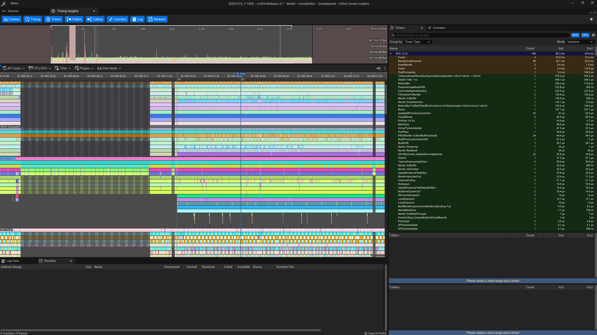
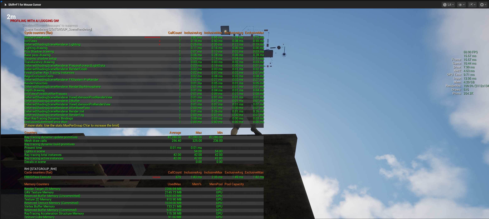

# Chaos Up

## Game

### 1. Project

Chaos Up is a vertical platforming game inspired by the *Only Up* genre. The main objective is to climb to 200m by navigating through obstacles, performing parkour movements, interacting with the environment, and using gameplay mechanics to reach new heights.

The game focuses on vertical progression, precise movement, environmental hazards, explosive interactions, and dynamic audiovisual feedback.

---

### 2. Architecture

The project is divided into five main systems:

| System | Responsibilities |

| **Player & Gameplay System** | Movement, jumping, parkour, climbing, and vertical progression. |

| **Environment & Interaction System** | Launch pads, destructible walls, temporary platforms, swinging hazards, explosive barrels, and the finish area. |

| **Visual Feedback System** | Dynamic camera effects, particles, explosions, destruction effects, and celebration effects. |

| **Audio System** | Movement sounds, impacts, explosions, destruction, and victory audio. |

| **UI System** | Player height display and progression feedback. |

Each system is responsible for its own logic and communicates with other systems through clearly defined interfaces or gameplay events whenever possible.

---

### 3. Player & Gameplay System

#### 3.1. Player Controller

The Player Controller is responsible for the player's core movement and interaction with the world.

It serves as the foundation for all movement-related mechanics and provides the information required by other systems, such as player velocity, movement state, and grounded status.

- Handle player movement and acceleration.
- Manage jumping and landing.
- Track player velocity and movement states.
- Detect transitions between movement modes.
- Provide movement information to camera and feedback systems.

The controller should remain independent of cosmetic effects such as particles, camera shake, and sound playback.

#### 3.2. Launch Pad

Launch Pads are interactive objects that propel the player vertically, allowing access to higher areas.

- Detect player contact.
- Apply a configurable launch force.
- Trigger the appropriate visual and audio feedback.
- Communicate the launch event to relevant systems.

Launch Pads should be reusable components with configurable launch strength and activation behavior.

#### 3.3. Destructible Wall

Destructible Walls act as obstacles that prevent the player from progressing until a specific interaction occurs.

- Detect the required interaction or impact.
- Validate destruction conditions.
- Trigger the destruction event.
- Disable or remove the wall.
- Notify visual and audio systems.

Destruction logic should be separated from destruction effects so that the same system can be reused for different environmental objects.

#### 3.4. Parkour & Edge Climbing

The Parkour System extends the standard movement mechanics by allowing the player to interact with ledges and climb onto elevated surfaces.

- Detect climbable edges.
- Validate whether a ledge can be reached.
- Handle grabbing, hanging, and climbing transitions.
- Return control to the standard movement system when the action ends.
- Prevent invalid interactions with the environment.

Parkour should be implemented as a dedicated movement state or subsystem that integrates with the Player Controller.

#### 3.5. Temporary Platforms

Temporary Platforms provide short-lived traversal opportunities and introduce time pressure during vertical progression.

- Detect player contact.
- Start a configurable destruction timer.
- Trigger warning feedback when necessary.
- Destroy or deactivate the platform when the timer expires.
- Notify the feedback systems when the platform is destroyed.

Platform timing and behavior should be configurable independently for gameplay balancing.

#### 3.6. **Pendulums & Wrecking Balls

Swinging hazards create moving obstacles that require timing and precision to avoid.

- Control the movement of pendulums and swinging balls.
- Detect collisions with the player and the environment.
- Trigger relevant impact feedback.
- Support configurable movement speed, amplitude, and timing.

The hazard movement logic should remain independent of the Player Controller, while collision events can be used to trigger gameplay consequences and feedback.

#### 3.7. Explosive Barrels

Explosive Barrels introduce projectile-based interactions into the gameplay.

The player must throw a projectile at a barrel to trigger its explosion.

- Detect projectile impacts.
- Validate whether the barrel can be detonated.
- Prevent multiple detonations of the same barrel.
- Execute the explosion gameplay logic.
- Trigger explosion-related events.

The explosion system may also apply forces, destroy nearby objects, or interact with other gameplay elements when required.

Explosion logic should be reusable across different explosive objects.

#### 3.8. Finish Platform

The Finish Platform represents the final objective of the level.

When the player reaches the designated area, the game validates completion and triggers the end-game sequence.

- Detect player arrival.
- Validate level completion.
- Notify the game state system.
- Trigger victory audio and celebration particles.
- Prevent the completion sequence from being triggered multiple times.

The completion logic should remain separate from the visual celebration effects.

---

### 4. Visual Feedback System

The Visual Feedback System enhances gameplay readability and reinforces the sensation of speed, impact, danger, and progression.

It reacts to gameplay events rather than implementing gameplay logic itself.

#### 4.1. Dynamic Camera

The camera system adapts its behavior according to player movement and important gameplay events.

| Feature | Description |

| **Camera Shake** | Adds impact and intensity during explosions and significant collisions. |

| **Slow Motion** | Temporarily slows gameplay during major explosions to emphasize their impact. |

| **Dynamic Field of View (FOV)** | Adjusts the camera's field of view according to player speed. |

| **Falling Effects** | Intensifies visual feedback during falls through camera effects and a screen vignette. |

| **Speed Feedback** | Uses camera adjustments to communicate acceleration and momentum. |

Camera effects should be controlled by a dedicated camera feedback system that receives events from gameplay components.

For example, an explosion should notify the camera system rather than directly controlling camera behavior from the explosive barrel.

#### 4.2. Particle System

Particles provide immediate visual feedback for player actions and environmental interactions.

| **Event** | Particle Effect |

| **Running** | Small particles around the player's feet. |

| **Jumping** | Takeoff particles. |

| **Explosion** | Blast effects, sparks, and debris. |

| **Platform Destruction** | Fragments and dust. |

| **Level Completion** | Celebration confetti. |

Particle effects should be reusable and triggered by the corresponding gameplay events.

Where appropriate, frequently used effects can be pooled to reduce runtime instantiation costs.

---

### 5. Audio System

The Audio System manages sounds associated with movement, interactions, hazards, destruction, and level completion.

Audio playback should be separated from gameplay logic and triggered by events.

| **Event** | Audio Feedback |

| **Player Movement** | Footsteps and running sounds. |

| **Explosion** | Explosion sound. |

| **Object Destruction** | Breaking and destruction sounds. |

| **Pendulums & Wrecking Balls** | Movement and impact sounds. |

| **Level Completion** | Victory sound or completion cue. |

The system should support centralized audio configuration, allowing sound effects to be adjusted without modifying the underlying gameplay mechanics.

---

### 6. UI System

#### 6.1. Height Display

The Height Display communicates the player's current vertical progression.

It provides continuous feedback on how high the player has climbed and reinforces the main objective of the game.

- Retrieve the player's vertical position.
- Convert the position into a readable height value.
- Update the displayed value during gameplay.
- Use a consistent unit of measurement.
- Keep the displayed value synchronized with the player's progression.

Height calculation should be handled separately from UI presentation. The progression system provides the height value, while the UI is responsible only for displaying it.

This separation allows the interface to change without affecting gameplay logic.

---

## Debug

### CVD

Before Chaos Collisions

After Chaos Collisions

### Show Physic Collision

Before Show Collision

After Show Collision

### Visual Logger

### Unreal Insight

### Command Stats

